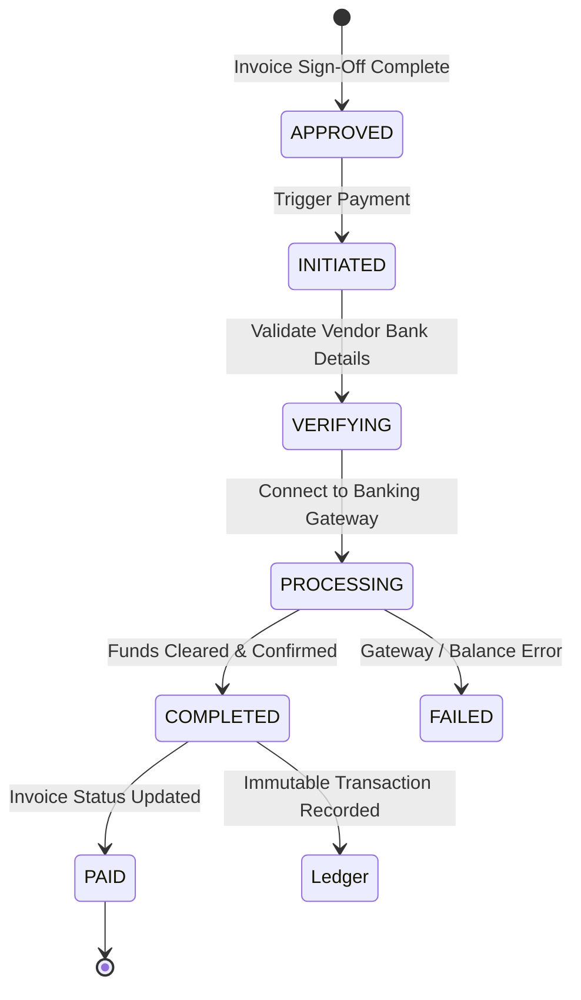
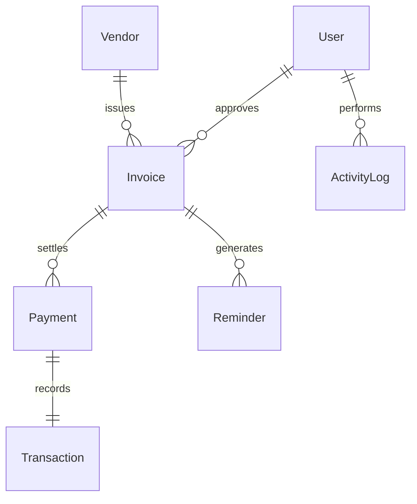

# INVOXA — Intelligent Invoice Operations & Vendor Payment Management Platform

[](https://reactjs.org/)
[](https://nodejs.org/)
[](https://www.mongodb.com/)
[](https://vitejs.dev/)
[](https://tailwindcss.com/)
[](LICENSE)
[](https://github.com/YuvaUmayaShri/invoxa)

> **INVOXA** is an enterprise-grade full-stack financial operations platform designed to automate invoice ingestion, multi-signal verification, intelligent duplicate fraud detection, multi-tier approvals, vendor management, and payment execution with audited transaction trails.

---

## 📑 Table of Contents

1. [Executive Overview & Value Proposition](#-executive-overview--value-proposition)
2. [High-Level Architecture](#-high-level-architecture)
3. [Complete Project Directory Structure](#-complete-project-directory-structure)
4. [File-by-File Technical Directory & Purpose Reference](#-file-by-file-technical-directory--purpose-reference)
   - [4.1 Root Workspace Files](#41-root-workspace-files)
   - [4.2 Backend Server (`server/`)](#42-backend-server-server)
   - [4.3 Frontend Client (`client/`)](#43-frontend-client-client)
5. [Core Engines & Business Algorithms](#-core-engines--business-algorithms)
   - [5.1 7-Point Automated Verification Engine](#51-7-point-automated-verification-engine)
   - [5.2 Multi-Signal Duplicate Detection Engine](#52-multi-signal-duplicate-detection-engine)
   - [5.3 Payment Processing & Banking Simulation](#53-payment-processing--banking-simulation)
   - [5.4 Dynamic Date Priority & Overdue Logic](#54-dynamic-date-priority--overdue-logic)
   - [5.5 Automated Background Reminder Engine](#55-automated-background-reminder-engine)
6. [Database Schema & Data Models](#-database-schema--data-models)
7. [Comprehensive REST API Reference](#-comprehensive-rest-api-reference)
8. [Role-Based Access Control (RBAC) Matrix](#-role-based-access-control-rbac-matrix)
9. [Installation & Developer Quickstart](#-installation--developer-quickstart)
10. [Environment Variables Reference](#-environment-variables-reference)
11. [Step-by-Step Testing & Verification Workflows](#-step-by-step-testing--verification-workflows)
12. [Design System & Theme Tokens](#-design-system--theme-tokens)
13. [Developer Onboarding & Extension Guidelines](#-developer-onboarding--extension-guidelines)

---

## 🌟 Executive Overview & Value Proposition

Traditional Accounts Payable (AP) workflows face critical operational bottlenecks:
- **Manual Data Entry Errors**: Calculation mismatches between line items, taxes, and totals.
- **Accidental Duplicate Disbursements**: Vendors submitting identical invoices under slight variations or across separate cycles.
- **Delayed Approvals & Late Fees**: Lack of prioritized visibility for impending or overdue liabilities.
- **Fragmented Visibility**: Absence of unified audit trails connecting an invoice document to approval sign-offs and payment receipts.

**INVOXA solves these challenges through:**
1. **Automated 7-Point Audit Engine**: Validates vendor registration, invoice formatting, timeline feasibility, mathematical line-item integrity, and GST rates.
2. **Multi-Signal Duplicate Engine**: Evaluates Levenshtein distance on invoice numbers, exact SHA-256 file hashes, amount matching, date proximity, and Jaccard OCR token similarity.
3. **Action-Oriented Dashboard**: Features an instant Overdue Liability Banner, top actionable invoices, and real-time KPI metrics.
4. **Interactive Payment Simulation**: Multi-state payment processing (`INITIATED` → `VERIFYING` → `PROCESSING` → `COMPLETED`) with automated ledger transaction generation.
5. **Zero-Configuration MongoDB Fallback**: Connects directly to local/Atlas MongoDB or boots an embedded `MongoMemoryServer` if no external database is available.

---

## 🏗 High-Level Architecture

```
┌─────────────────────────────────────────────────────────────────────────────┐
│                           CLIENT TIER (React 18 + Vite)                     │
│  React Router v6 │ Tailwind CSS (Warm Charcoal) │ Recharts │ Context APIs  │
└──────────────────────────────────────┬──────────────────────────────────────┘
                                       │ HTTP / REST + Bearer JWT
┌──────────────────────────────────────▼──────────────────────────────────────┐
│                           SERVER TIER (Node.js + Express)                   │
│  ┌────────────────────┬────────────────────┬─────────────────────────────┐  │
│  │ Auth & RBAC Guards │ Controller Handlers│ Business Services Engine    │  │
│  │ (JWT, Roles)       │ (10 REST Resources)│ • 7-Point Verification      │  │
│  │                    │                    │ • Multi-Signal Duplicates   │  │
│  │                    │                    │ • Payment State Engine      │  │
│  │                    │                    │ • Automated Reminders       │  │
│  └────────────────────┴────────────────────┴─────────────────────────────┘  │
└──────────────────────────────────────┬──────────────────────────────────────┘
                                       │ Mongoose ORM
┌──────────────────────────────────────▼──────────────────────────────────────┐
│                           DATA TIER (MongoDB)                               │
│  Primary: MongoDB URI (Local/Atlas) ──[Failover]──► MongoMemoryServer (RAM) │
│  Collections: Users, Vendors, Invoices, Payments, Transactions, Logs, etc.  │
└─────────────────────────────────────────────────────────────────────────────┘
```

---

## 📂 Complete Project Directory Structure

```
INVOXA/
├── package.json                              # Root multi-package orchestration
├── package-lock.json                         # Root dependency lockfile
├── README.md                                 # Master project documentation
│
├── server/                                   # Express.js REST API Backend
│   ├── .env                                  # Active environment config
│   ├── .env.example                          # Environment template
│   ├── package.json                          # Backend dependencies & scripts
│   ├── package-lock.json                     # Backend lockfile
│   ├── server.js                             # HTTP server entry point & jobs
│   ├── app.js                                # Express middleware & routing
│   │
│   ├── config/
│   │   └── db.js                             # MongoDB connection + in-memory fallback
│   │
│   ├── controllers/                          # REST API route handlers
│   │   ├── activityController.js             # Audit log queries
│   │   ├── approvalController.js             # Invoice approval & sign-off
│   │   ├── authController.js                 # Login, register, profile
│   │   ├── invoiceController.js              # Full CRUD, upload, verification
│   │   ├── notificationController.js         # Alerts and user notifications
│   │   ├── paymentController.js              # Payment execution & status
│   │   ├── reportController.js               # Analytics & cashflow aggregations
│   │   ├── transactionController.js          # Financial ledger queries
│   │   ├── userController.js                 # User administration
│   │   └── vendorController.js               # Vendor master data
│   │
│   ├── middleware/                           # Express custom middleware
│   │   ├── authMiddleware.js                 # JWT verification & req.user injection
│   │   ├── errorMiddleware.js                # Centralized error handler
│   │   ├── roleMiddleware.js                 # RBAC permission checker
│   │   └── uploadMiddleware.js               # Multer file upload setup
│   │
│   ├── models/                               # Mongoose schema definitions
│   │   ├── ActivityLog.js                    # Audit trail records
│   │   ├── Invoice.js                        # Master invoice model
│   │   ├── Notification.js                   # In-app notifications
│   │   ├── Payment.js                        # Payment records
│   │   ├── Reminder.js                       # Scheduled reminders
│   │   ├── Transaction.js                    # Financial ledger transactions
│   │   ├── User.js                           # Users with bcrypt passwords
│   │   └── Vendor.js                         # Vendor master records
│   │
│   ├── routes/                               # Express endpoint routers
│   │   ├── activityRoutes.js                 # /api/activities
│   │   ├── approvalRoutes.js                 # /api/approvals
│   │   ├── authRoutes.js                     # /api/auth
│   │   ├── invoiceRoutes.js                  # /api/invoices
│   │   ├── notificationRoutes.js             # /api/notifications
│   │   ├── paymentRoutes.js                  # /api/payments
│   │   ├── reportRoutes.js                   # /api/reports
│   │   ├── transactionRoutes.js              # /api/transactions
│   │   ├── userRoutes.js                     # /api/users
│   │   └── vendorRoutes.js                   # /api/vendors
│   │
│   ├── seed/                                 # Initial data & seeder
│   │   ├── seedData.js                       # Comprehensive demo dataset
│   │   └── seeder.js                         # Standalone seeding script
│   │
│   ├── services/                             # Core business logic engines
│   │   ├── duplicateService.js               # Multi-signal duplicate detection
│   │   ├── paymentService.js                 # Payment lifecycle & state machine
│   │   ├── reminderService.js                # Automated overdue reminders
│   │   └── verificationService.js            # 7-point automated invoice verification
│   │
│   ├── utils/                                # Backend helper utilities
│   │   ├── apiResponse.js                    # Standardized response format
│   │   └── datePriority.js                   # Dynamic urgency calculator
│   │
│   └── uploads/                              # Uploaded invoice files storage
│
└── client/                                   # React + Vite Frontend
    ├── .env.example                          # Client environment template
    ├── index.html                            # HTML entry point
    ├── package.json                          # Client dependencies & scripts
    ├── package-lock.json                     # Client lockfile
    ├── postcss.config.js                     # PostCSS config
    ├── tailwind.config.js                    # Tailwind CSS Warm Charcoal theme
    ├── vite.config.js                        # Vite development configuration
    │
    ├── public/                               # Static vector assets
    │   ├── invoxa-favicon.svg                # Application browser favicon
    │   └── assets/
    │       ├── invoxa-logo-compact.svg       # Compact brand mark
    │       ├── invoxa-logo-dark.svg          # Dark mode brand banner
    │       └── invoxa-logo-horizontal.svg    # Primary horizontal logo
    │
    └── src/
        ├── App.jsx                           # Route configuration & Auth guards
        ├── main.jsx                          # React DOM entry point
        │
        ├── components/
        │   ├── common/                       # Reusable UI components
        │   │   ├── ConfirmDialog.jsx         # Modal confirmation dialog
        │   │   ├── EmptyState.jsx            # Zero-data placeholder
        │   │   ├── GlobalSearchModal.jsx     # Global search dialog (Ctrl+K)
        │   │   ├── LoadingSkeleton.jsx       # Card & table skeleton loaders
        │   │   ├── Mascot.jsx                # Animated guide mascot
        │   │   ├── Modal.jsx                 # Base accessible modal wrapper
        │   │   ├── PaymentProcessModal.jsx   # Interactive payment execution modal
        │   │   ├── PriorityBadge.jsx         # Overdue/High/Medium/Low badge
        │   │   ├── ProfileDrawer.jsx         # Slide-out user profile drawer
        │   │   ├── StatCard.jsx              # Dashboard KPI card
        │   │   └── StatusBadge.jsx           # Semantic colored status pill
        │   │
        │   ├── dashboard/                    # Dashboard specific widgets
        │   │   ├── ChartsSection.jsx         # Mini trend visualizers
        │   │   ├── OverdueBanner.jsx         # Urgent overdue invoice banner
        │   │   ├── PendingApprovalsWidget.jsx# Quick sign-off widget
        │   │   ├── RecentActivityWidget.jsx  # Activity log timeline
        │   │   └── SignOffDetailsModal.jsx   # Multi-tier sign-off audit modal
        │   │
        │   ├── invoices/                     # Invoice feature components
        │   │   └── InvoiceUploadModal.jsx    # Drag-and-drop upload & invoice creator
        │   │
        │   ├── layout/                       # Structural layout shell
        │   │   ├── AppLayout.jsx             # Shell wrapper (Sidebar + Navbar + Content)
        │   │   ├── Navbar.jsx                # Top bar (Search, Alert Bell, Theme, Profile)
        │   │   └── Sidebar.jsx               # Navigation bar with role-aware links
        │   │
        │   └── ui/                           # Interactive animations
        │       ├── GreetingAnimation.jsx     # Time-of-day greeting badge
        │       ├── IntroScreen.jsx           # Initial application splash animation
        │       └── WelcomeAnimation.jsx      # Post-login greeting banner
        │
        ├── context/                          # Global React State Providers
        │   ├── AuthContext.jsx               # User authentication & token storage
        │   ├── NotificationContext.jsx       # System alerts & polling
        │   ├── ThemeContext.jsx              # Light / Warm Charcoal theme toggling
        │   └── ToastContext.jsx              # Dismissible feedback toast system
        │
        ├── pages/                            # Full page routing views
        │   ├── activity/ActivityLogPage.jsx  # Audit log repository
        │   ├── approvals/ApprovalsPage.jsx   # Sign-off & authorization queue
        │   ├── auth/LoginPage.jsx            # Split-screen auth with demo pills
        │   ├── dashboard/DashboardPage.jsx   # Core operations dashboard (4 KPIs)
        │   ├── invoices/InvoicesPage.jsx     # Master invoice repository & filter
        │   ├── payments/PaymentsPage.jsx     # Payment execution & batch processing
        │   ├── reports/ReportsPage.jsx       # Recharts financial analytics suite
        │   ├── settings/SettingsPage.jsx     # System & user preferences
        │   ├── transactions/TransactionsPage.jsx # Audited financial ledger
        │   ├── vendors/VendorDetailPage.jsx  # 360-degree vendor profile & stats
        │   ├── vendors/VendorsPage.jsx       # Vendor directory & creation
        │   └── verification/VerificationPage.jsx # Automated 7-point audit console
        │
        ├── services/
        │   └── api.js                        # Centralized fetch client & API methods
        │
        ├── styles/
        │   └── index.css                     # Global styles, variables, Warm Charcoal tokens
        │
        └── utils/
            ├── exportCsv.js                  # Table dataset CSV exporter
            └── formatters.js                 # Currency (INR), date, and badge helpers
```

---

## 🔍 File-by-File Technical Directory & Purpose Reference

### 4.1 Root Workspace Files

| File | Type | Purpose & Key Responsibilities |
| :--- | :--- | :--- |
| `package.json` | Configuration | Defines root orchestration scripts (`npm run dev`, `npm run server`, `npm run client`, `npm run seed`, `npm run install:all`). Uses `concurrently` to run both backend and frontend servers in one command with colored terminal labels. |
| `package-lock.json` | Dependency Lock | Locks tree versions of root development tools like `concurrently`. |
| `README.md` | Documentation | This master architectural guide, comprehensive manual, file directory, and developer reference. |

---

### 4.2 Backend Server (`server/`)

#### Server Entry Points & Configuration
| File | Type | Purpose & Key Responsibilities |
| :--- | :--- | :--- |
| `server/server.js` | Entry Point | Bootstraps the application: establishes database connectivity via `config/db.js`, starts the scheduled reminder engine interval (`checkDueAndOverdueInvoices`), and binds the Express server to port `5000`. |
| `server/app.js` | Express Config | Configures Express middleware: CORS policy with credentials, body parsers (`express.json()`, `urlencoded`), Morgan request logging, static serving of the `uploads/` folder, attaches all 10 API route handlers, and sets up global 404 and error-handling middleware. |
| `server/config/db.js` | DB Connection | Dual-mode MongoDB connector: attempts connection to `MONGODB_URI` (local or remote MongoDB). If MongoDB is unavailable or fails, it automatically spins up an in-memory database using `mongodb-memory-server` and triggers initial data seeding. |
| `server/.env` | Environment | Active backend environment variable configuration containing port, DB connection strings, and JWT secret keys. |
| `server/.env.example` | Template | Version-controlled environment variables template for new developer onboarding. |
| `server/package.json` | Dependencies | Declares backend libraries: `express`, `mongoose`, `jsonwebtoken`, `bcryptjs`, `multer`, `cors`, `dotenv`, `morgan`, `mongodb-memory-server`, and dev script with `nodemon`. |

#### Data Models (`server/models/`)
| File | Model Name | Key Schema Fields & Business Role |
| :--- | :--- | :--- |
| `models/User.js` | `User` | User accounts with `name`, `email` (unique), `password` (hashed with `bcryptjs` via pre-save hook), `role` (`ADMIN`, `ACCOUNTS_TEAM`, `VENDOR`), `status`, and helper method `matchPassword()`. |
| `models/Vendor.js` | `Vendor` | Vendor profiles with `companyName`, `vendorCode`, `taxId` (GSTIN), `email`, `phone`, `address`, `bankDetails` (account number, IFSC, bank name), `status`, `rating`, and `totalSpend`. |
| `models/Invoice.js` | `Invoice` | Core system model: `invoiceNumber`, `vendor` (ref), `invoiceDate`, `dueDate`, `amount`, `taxRate`, `taxAmount`, `items` array, `status`, `verificationStatus`, `verificationChecks` (7 boolean flags + score + details), duplicate tracking (`isDuplicate`, `duplicateConfidence`, `duplicateScoreBreakdown`), and approval metadata. |
| `models/Payment.js` | `Payment` | Records vendor disbursements: `invoice` (ref), `vendor` (ref), `amount`, `paymentMethod` (`BANK_TRANSFER`, `NEFT`, `RTGS`, `UPI`, `CARD`), `transactionReference`, `status` (`INITIATED`, `PROCESSING`, `COMPLETED`, `FAILED`), and processing timestamps. |
| `models/Transaction.js` | `Transaction` | Audited financial ledger recording successful debit movements, payment references, reconciled states, and accounting notes. |
| `models/ActivityLog.js` | `ActivityLog` | Immutable audit trail capturing `user` (ref), `action` (e.g., `INVOICE_CREATED`, `PAYMENT_PROCESSED`), `entityType`, `entityId`, `details`, IP address, and timestamp. |
| `models/Notification.js` | `Notification` | System alerts: `recipient` (ref or broadcast), `title`, `message`, `type` (`INFO`, `WARNING`, `DANGER`, `SUCCESS`), `isRead`, and actionable deep-link URL. |
| `models/Reminder.js` | `Reminder` | Automated reminder log tracking when overdue or upcoming payment alerts were dispatched for specific invoices to prevent duplicate notifications. |

#### Controllers (`server/controllers/`)
| File | Handled Resource | Key Controller Methods & Business Responsibilities |
| :--- | :--- | :--- |
| `controllers/authController.js` | Authentication | `register`: Validates user uniqueness and creates account.<br>`login`: Authenticates credentials with bcrypt and returns signed JWT.<br>`getMe`: Returns currently authenticated user details.<br>`logout`: Invalidates client session. |
| `controllers/invoiceController.js` | Invoices | `getInvoices`: Paginated, searchable, status-filtered query.<br>`getInvoiceById`: Returns complete invoice with vendor details.<br>`createInvoice`: Validates fields, triggers auto-verification and duplicate engine.<br>`updateInvoice`: Edits draft/pending invoice data.<br>`deleteInvoice`: Removes an invoice.<br>`uploadInvoiceFile`: Multer file handler with SHA-256 hash generation.<br>`reverifyInvoice`: Forces re-execution of 7-point verification audit.<br>`resolveDuplicate`: Allows authorized users to override duplicate flags. |
| `controllers/vendorController.js` | Vendors | `getVendors`: Lists registered vendors with spend aggregations.<br>`getVendorById`: Fetches 360-degree vendor profile with linked invoice history.<br>`createVendor`: Registers new supplier.<br>`updateVendor`: Updates vendor status or bank details.<br>`deleteVendor`: Deactivates vendor records. |
| `controllers/paymentController.js` | Payments | `getPayments`: Queries payment records with status and date filters.<br>`initiatePayment`: Validates invoice approval status and creates payment record in `INITIATED` state.<br>`processPayment`: Advances state machine to `COMPLETED`, updates invoice to `PAID`, generates ledger entry, and creates audit log. |
| `controllers/transactionController.js` | Ledger | `getTransactions`: Retrieves completed financial transactions with date and payment method filters for accounting reconciliation. |
| `controllers/approvalController.js` | Approvals | `getPendingApprovals`: Returns verified invoices awaiting sign-off.<br>`approveInvoice`: Authorizes invoice for payment execution.<br>`rejectInvoice`: Rejects invoice with required reason note.<br>`requestReview`: Sends invoice back to accounts team with queries. |
| `controllers/reportController.js` | Analytics | `getDashboardMetrics`: Computes 4 primary KPIs (Total, Pending Verification, Pending Approval, Overdue) and overdue banner data.<br>`getCashflowTrends`: Aggregates real monthly payments and upcoming obligations.<br>`getStatusBreakdown`: Computes invoice distribution across lifecycle states.<br>`getProcessingFunnel`: Tracks count of invoices at each processing stage.<br>`getTopVendors`: Returns top 8 vendors by payment volume. |
| `controllers/activityController.js` | Audit Logs | `getActivityLogs`: Retrieves chronologically sorted audit trail with action filtering and user attribution. |
| `controllers/notificationController.js` | Notifications | `getNotifications`: Fetches alerts for logged-in user.<br>`getUnreadCount`: Returns number of unread alerts.<br>`markAsRead`: Marks alert as read.<br>`markAllAsRead`: Bulk marks all alerts read. |
| `controllers/userController.js` | User Mgmt | `getUsers`: Admin listing of system users.<br>`updateUserProfile`: Updates personal user preferences and profile details. |

#### Middleware (`server/middleware/`)
| File | Role | Purpose & Execution Flow |
| :--- | :--- | :--- |
| `middleware/authMiddleware.js` | Authentication | Intercepts requests, extracts JWT token from `Authorization: Bearer <token>` header, decodes user ID, verifies signature, loads `User` from DB, and attaches to `req.user`. Rejects with 401 if missing/invalid. |
| `middleware/roleMiddleware.js` | Authorization (RBAC) | Factory function `authorize(...roles)` that checks `req.user.role`. Grants execution if permitted or halts with 403 Forbidden. |
| `middleware/uploadMiddleware.js` | File Processing | Configures `multer` disk storage to `./uploads/` with UUID-prefixed filenames, restricts file types to PDF, PNG, JPEG, and sets a 10MB file size ceiling. |
| `middleware/errorMiddleware.js` | Error Formatting | Global catch-all error middleware: catches unhandled promise rejections, formats Mongoose validation errors, duplicate key errors (11000), and outputs consistent JSON error payloads. |

#### Core Services & Business Engines (`server/services/`)
| File | Engine Name | Detailed Role & Algorithmic Design |
| :--- | :--- | :--- |
| `services/verificationService.js` | 7-Point Audit Engine | Evaluates invoice integrity: (1) Vendor registered & active, (2) Invoice number valid, (3) Due date $\ge$ Issue date, (4) Positive total amount, (5) Itemized line calculation consistency, (6) GST math check ($\pm₹2$ tolerance), (7) Calls duplicate engine. Produces a 0–100 score and verification details list. |
| `services/duplicateService.js` | Multi-Signal Duplicate Engine | Runs deterministic multi-signal comparison across existing invoices: exact/normalized number matching (40 pts), vendor matching (20 pts), amount parity (15 pts), issue date proximity (10 pts), PO number matching (10 pts), byte-level SHA-256 hash match (15 pts), and OCR token overlap (10 pts). Categorizes into `UNIQUE`, `LOW_RISK`, `POSSIBLE_DUPLICATE`, or `CONFIRMED_DUPLICATE`. |
| `services/paymentService.js` | Payment Lifecycle Engine | Coordinates simulated bank settlement: transitions state from `INITIATED` $\to$ `PROCESSING` $\to$ `COMPLETED`, updates invoice status to `PAID`, populates paid timestamp, writes to `Transaction` ledger, and records audit trail. |
| `services/reminderService.js` | Automated Reminder Daemon | Periodically inspects unpaid invoices in the database. Dispatches in-app notifications for invoices due within 3 days and those that are officially overdue, avoiding duplicate notifications within a 24-hour window. |

#### Utilities & Seed (`server/utils/` & `server/seed/`)
| File | Type | Purpose & Key Responsibilities |
| :--- | :--- | :--- |
| `utils/apiResponse.js` | Helper | Standardizes API JSON responses with unified shapes: `{ success: true, data: ..., message: ... }` or `{ success: false, error: ... }`. |
| `utils/datePriority.js` | Helper | Centralized calculation for invoice urgency: determines whether an invoice is `OVERDUE`, `HIGH`, `MEDIUM`, or `LOW` priority based on status and days remaining until `dueDate`. |
| `seed/seedData.js` | Fixture Data | Comprehensive enterprise seed dataset featuring 3 user roles, 6 registered vendors, 21 diverse invoices across all lifecycle states (including intentional duplicate pairs and overdue items), payments, and activity logs. |
| `seed/seeder.js` | Runner | Standalone script (`npm run seed`) that connects to MongoDB, drops existing collections, and repopulates them with `seedData.js`. |

---

### 4.3 Frontend Client (`client/`)

#### Configuration, Root & Styling
| File | Type | Purpose & Key Responsibilities |
| :--- | :--- | :--- |
| `client/index.html` | HTML Entry | Primary single-page HTML skeleton: configures page title, favicon, responsive viewport meta tags, and loads Google Fonts (Inter & Outfit). |
| `client/vite.config.js` | Bundler Config | Vite build configuration with `@vitejs/plugin-react` and local dev server settings. |
| `client/tailwind.config.js` | Theme Config | Tailwind configuration implementing the custom **Warm Charcoal** design system (`#121110`, `#1A1816`, `#24211E`, `#2E2A27`) with Emerald (`#10B981`) and Amber accents. |
| `client/postcss.config.js` | PostCSS | Configures PostCSS to run Tailwind CSS and Autoprefixer. |
| `client/src/main.jsx` | React Root | Bootstraps the React DOM tree, wrapping `<App />` with Context Providers (`ThemeProvider`, `AuthProvider`, `ToastProvider`, `NotificationProvider`). |
| `client/src/App.jsx` | Router & Shell | Top-level routing using React Router v6: declares public `/login` route, wraps authenticated views in `<AppLayout>`, establishes protected routes, and handles global modals. |
| `client/src/styles/index.css` | Design Tokens | Master stylesheet containing CSS custom properties for light/dark themes, custom scrollbars, glassmorphism utilities, and typography defaults. |

#### Global State Management (`client/src/context/`)
| File | Context | Role & Exported State / Methods |
| :--- | :--- | :--- |
| `context/AuthContext.jsx` | `AuthContext` | Manages authenticated user state (`user`, `token`, `isAuthenticated`, `loading`). Persists token in `localStorage`, provides `login()` and `logout()` methods. |
| `context/ThemeContext.jsx` | `ThemeContext` | Manages application theme (`theme`: `'dark'` \| `'light'`), syncs with `document.documentElement` class list, and saves selection to `localStorage`. |
| `context/ToastContext.jsx` | `ToastContext` | Provides global dismissible toast alerts (`showToast(message, type, duration)`), supporting `success`, `error`, `warning`, and `info`. |
| `context/NotificationContext.jsx` | `NotificationContext` | Polls unread notifications every 30 seconds, manages notification dropdown state, and provides `markAsRead()` and `markAllAsRead()` helpers. |

#### Services & Client Utilities (`client/src/services/` & `client/src/utils/`)
| File | Role | Purpose & Key Functions |
| :--- | :--- | :--- |
| `services/api.js` | Central API Client | Fetch abstraction that automatically attaches `Authorization: Bearer <token>`, manages API base URL, parses error responses, and exposes structured endpoint methods (`authAPI`, `invoiceAPI`, `vendorAPI`, `paymentAPI`, `reportAPI`, `approvalAPI`, `activityAPI`). |
| `utils/formatters.js` | Utility Helpers | Functions for formatting currency in Indian Rupees (`formatCurrency(amount)` $\to$ ₹50,000), dates (`formatDate(date)`), relative time ("2 days ago"), and status labels. |
| `utils/exportCsv.js` | CSV Exporter | Transforms array-of-objects data into formatted, browser-downloadable `.csv` files for tables in Invoices, Transactions, and Reports. |

#### Layout Components (`client/src/components/layout/`)
| File | Component | UI & Functional Responsibility |
| :--- | :--- | :--- |
| `components/layout/AppLayout.jsx` | Shell Wrapper | Core layout grid: renders fixed `Sidebar`, sticky `Navbar`, scrollable content container, global modals, and footer. |
| `components/layout/Sidebar.jsx` | Navigation Bar | Left navigation drawer displaying INVOXA brand logo, navigation links with active indicators, badges (e.g., pending count), role-restricted menus, and collapse toggle. |
| `components/layout/Navbar.jsx` | Header Bar | Top navigation bar with quick global search button (`Ctrl+K`), notification bell with unread badge, light/dark theme toggle, and user avatar triggering the profile drawer. |

#### Common UI Components (`client/src/components/common/`)
| File | Component | UI & Functional Responsibility |
| :--- | :--- | :--- |
| `components/common/StatCard.jsx` | KPI Card | Premium dashboard metric card showing title, value, icon with colored badge, percentage trend change, and loading skeleton states. |
| `components/common/StatusBadge.jsx` | Status Pill | Standardized status pill with color coding for all invoice/payment states (`PAID` $\to$ Green, `PENDING` $\to$ Amber, `OVERDUE` $\to$ Red, `VERIFIED` $\to$ Cyan). |
| `components/common/PriorityBadge.jsx` | Urgency Badge | Visual badge indicating urgency level (`OVERDUE`, `HIGH`, `MEDIUM`, `LOW`) calculated dynamically from due dates. |
| `components/common/Modal.jsx` | Modal Dialog | Accessible modal wrapper with backdrop blur, keyboard `Escape` handler, click-outside dismissal, and smooth scale transitions. |
| `components/common/ConfirmDialog.jsx` | Confirm Alert | Dialog requesting explicit user confirmation for destructive actions (e.g., invoice deletion, payment processing, duplicate override). |
| `components/common/EmptyState.jsx` | Empty State | Polished empty-state illustration with customizable title, explanatory text, and primary call-to-action button. |
| `components/common/LoadingSkeleton.jsx` | Skeleton Loader | Shimmer skeleton loader matching table rows, metric cards, and charts during asynchronous data fetching. |
| `components/common/GlobalSearchModal.jsx` | Global Spotlight | Spotlight modal triggered by `Ctrl+K` or search bar, offering real-time search across invoices, vendors, and transactions. |
| `components/common/ProfileDrawer.jsx` | Profile Flyout | Slide-out right drawer showing current user profile details, role badge, session status, and quick settings links. |
| `components/common/PaymentProcessModal.jsx` | Payment Engine Modal | Interactive payment modal rendering real-time animated banking stages (`Verifying Bank Details` $\to$ `Initiating Gateway` $\to$ `Authorizing Funds` $\to$ `Completed`) with confetti celebration on success. |
| `components/common/Mascot.jsx` | Interactive Avatar | Engaging brand mascot that provides contextual hints, verification tips, and status feedback. |

#### Dashboard Widgets (`client/src/components/dashboard/`)
| File | Component | UI & Functional Responsibility |
| :--- | :--- | :--- |
| `components/dashboard/OverdueBanner.jsx` | Urgent Alert Banner | Prominently displayed top banner highlighting the single most critical overdue invoice with days overdue and a direct "Settle Now" action button. |
| `components/dashboard/PendingApprovalsWidget.jsx` | Sign-Off Widget | Actionable dashboard card listing urgent invoices pending financial authorization with one-click approve/reject actions. |
| `components/dashboard/RecentActivityWidget.jsx` | Audit Feed | Timeline feed displaying the 5 most recent system actions with relative timestamps and user tags. |
| `components/dashboard/ChartsSection.jsx` | Mini Charts | Visual cards displaying spending trends and status breakdown previews on the dashboard. |
| `components/dashboard/SignOffDetailsModal.jsx` | Sign-Off Detail Modal | Displays complete multi-stage approval history, auditor comments, and timestamps for an individual invoice. |

#### Invoice & Animation Components (`client/src/components/invoices/` & `client/src/components/ui/`)
| File | Component | UI & Functional Responsibility |
| :--- | :--- | :--- |
| `components/invoices/InvoiceUploadModal.jsx` | Invoice Creator Modal | Multi-tab modal supporting drag-and-drop file upload (PDF/images), file metadata extraction, line-item entry, and instant verification preview. |
| `components/ui/IntroScreen.jsx` | Splash Screen | Elegant entry animation introducing the INVOXA brand when first loading the application. |
| `components/ui/GreetingAnimation.jsx` | Dynamic Greeting | Personalized greeting widget calculating morning/afternoon/evening greetings with user role context. |
| `components/ui/WelcomeAnimation.jsx` | Login Celebration | Micro-animation confirming successful authentication during login transitions. |

#### Full Application Pages (`client/src/pages/`)
| File | Route | Page Purpose & User Capabilities |
| :--- | :--- | :--- |
| `pages/auth/LoginPage.jsx` | `/login` | Branded split-screen authentication page featuring one-click demo role auto-fill buttons (Admin, Accounts, Vendor) and secure JWT login. |
| `pages/dashboard/DashboardPage.jsx` | `/` | Executive operations center displaying the 4 core KPIs, Urgent Overdue Banner, Needs-Attention list, and Recent Activity timeline. |
| `pages/invoices/InvoicesPage.jsx` | `/invoices` | Master invoice repository: multi-field search, status filtering, priority badges, CSV export, creation modal trigger, and invoice details view. |
| `pages/verification/VerificationPage.jsx` | `/verification` | Audit workbench showing the 7-point verification checklist, duplicate detection status, confidence scores, and manual verification triggers. |
| `pages/approvals/ApprovalsPage.jsx` | `/approvals` | Management sign-off portal displaying verified invoices queued for financial authorization with comment threads and approval/rejection actions. |
| `pages/payments/PaymentsPage.jsx` | `/payments` | Vendor disbursement hub: lists approved payable invoices, supports batch payments, launches interactive payment simulation modal, and displays receipts. |
| `pages/transactions/TransactionsPage.jsx` | `/transactions` | Audited financial ledger displaying settled transaction records, reference numbers, payment channels, and CSV export. |
| `pages/vendors/VendorsPage.jsx` | `/vendors` | Vendor master directory displaying vendor cards with contact info, GSTIN, active status, total spend, rating, and new vendor creation. |
| `pages/vendors/VendorDetailPage.jsx` | `/vendors/:id` | 360-degree vendor profile displaying bank details, lifetime transaction totals, and linked historical invoices. |
| `pages/reports/ReportsPage.jsx` | `/reports` | Financial analytics suite powered by Recharts: tabbed views for Monthly Cashflow Trends, Status Distribution Donut, Processing Funnel, and Top Vendors Outflow. |
| `pages/activity/ActivityLogPage.jsx` | `/activity` | System-wide audit log table tracking user actions, entity types, changes, and timestamps with full-text search and filtering. |
| `pages/settings/SettingsPage.jsx` | `/settings` | User profile management, password updates, theme preference toggling, and system notifications configuration. |

---

## ⚙️ Core Engines & Business Algorithms

### 5.1 7-Point Automated Verification Engine
Implemented in `server/services/verificationService.js`, every ingested invoice undergoes an automated 7-point audit check resulting in a deterministic score (0–100):

| Check # | Audit Rule | Scoring Weight | Validation Logic |
| :---: | :--- | :---: | :--- |
| **1** | **Vendor Registration** | **20 pts** | Validates that `invoice.vendor` references a registered, `ACTIVE` vendor in the database. |
| **2** | **Invoice Number Format** | **15 pts** | Ensures `invoiceNumber` exists, is trimmed, and has a minimum length of 3 alphanumeric characters. |
| **3** | **Timeline Feasibility** | **20 pts** | Verifies `invoiceDate` and `dueDate` are valid dates and enforces `dueDate >= invoiceDate`. |
| **4** | **Amount Integrity** | **15 pts** | Validates that total invoice `amount` is a valid positive number greater than 0. |
| **5** | **Line-Item Math** | **15 pts** | If line items are present, iterates items to verify `amount == quantity * unitPrice` and matches subtotal. |
| **6** | **Tax Consistency** | **15 pts** | Re-computes declared GST tax rate: `expectedTax = (subtotal * taxRate) / 100`. Enforces $|\Delta| \le ₹2$ tolerance. |
| **7** | **Duplicate Inspection** | **Pass/Fail** | Evaluates invoice against existing records via `duplicateService.js`. |

**Resulting Statuses**:
- **`VERIFIED`**: Score $\ge 80$, all required checks pass, and duplicate check clean.
- **`NEEDS_REVIEW`**: Warning condition or minor mismatch detected.
- **`INVALID`**: Missing vendor, malformed dates, or mathematical discrepancy.

---

### 5.2 Multi-Signal Duplicate Detection Engine
Implemented in `server/services/duplicateService.js`, this engine prevents accidental duplicate disbursements using a multi-factor weighted scoring model (0–100%):

```
Duplicate Confidence Score = 
    Invoice Number Match   (Max 40 pts)
  + Vendor Identity Match  (Max 20 pts)
  + Amount Similarity      (Max 15 pts)
  + Date Proximity         (Max 10 pts)
  + PO Number Match        (Max 10 pts)
  + File SHA-256 Hash      (Max 15 pts)
  + OCR Text Similarity    (Max 10 pts)
  ─────────────────────────────────────
  Composite Score Capped at 100%
```

- **Invoice Number Normalization**: Strips spaces, punctuation, and casing (e.g., `INV - 2026 / 001` $\to$ `inv2026001`). If not identical, computes string edit distance (Levenshtein distance).
- **Thresholds**:
  - **$\ge 80\%$** $\to$ `CONFIRMED_DUPLICATE` (Flagged, blocked from approval)
  - **$55\% - 79\%$** $\to$ `POSSIBLE_DUPLICATE` (Requires manual verification sign-off)
  - **$30\% - 54\%$** $\to$ `LOW_RISK`
  - **$< 30\%$** $\to$ `UNIQUE`

---

### 5.3 Payment Processing & Banking Simulation
Implemented in `server/services/paymentService.js` and `client/src/components/common/PaymentProcessModal.jsx`:



1. **Prerequisite Check**: Only invoices in `APPROVED` state can be paid.
2. **State Machine Execution**: Simulates sequential banking gateway phases with progress telemetry.
3. **Ledger Generation**: On `COMPLETED`, automatically creates a permanent record in `Transaction` collection.
4. **Invoice Synchronization**: Updates `Invoice.status = 'PAID'` and sets `paidAt = new Date()`.

---

### 5.4 Dynamic Date Priority & Overdue Logic
Implemented centrally in `server/utils/datePriority.js` to ensure the Dashboard Banner, Invoice Repository, and Reports always display identical priority metrics:

$$\Delta\text{Days} = \left\lfloor \frac{\text{dueDate} - \text{Current Date}}{86,400,000\,\text{ms}} \right\rfloor$$

- **`OVERDUE`**: $\Delta\text{Days} < 0$ and invoice is unpaid.
- **`HIGH`**: $0 \le \Delta\text{Days} \le 3$ (Due within 72 hours).
- **`MEDIUM`**: $4 \le \Delta\text{Days} \le 7$ (Due within one week).
- **`LOW`**: $\Delta\text{Days} > 7$ (Due in more than a week).

---

### 5.5 Automated Background Reminder Engine
Implemented in `server/services/reminderService.js`:
- Runs periodically on the backend HTTP server.
- Scans for invoices where status is not `PAID` or `REJECTED`.
- Checks for upcoming deadlines ($\le 3$ days) and overdue items.
- Inserts actionable alerts into `Notification` collection for users with `ACCOUNTS_TEAM` and `ADMIN` roles.
- Logs dispatched alerts in `Reminder` collection with a 24-hour deduplication window.

---

## 🗄 Database Schema & Data Models

### Entity Relationship Overview



### Model Schema Summary

| Model | Collection | Primary Fields | Key Relationships |
| :--- | :--- | :--- | :--- |
| **`User`** | `users` | `name`, `email`, `password` (hash), `role`, `status` | Ref in `Invoice.approvedBy`, `ActivityLog.user` |
| **`Vendor`** | `vendors` | `companyName`, `vendorCode`, `taxId`, `email`, `bankDetails`, `totalSpend` | Ref in `Invoice.vendor`, `Payment.vendor` |
| **`Invoice`** | `invoices` | `invoiceNumber`, `amount`, `subtotal`, `taxAmount`, `status`, `verificationChecks`, `isDuplicate`, `dueDate` | `vendor` $\to$ Vendor, `approvedBy` $\to$ User, `duplicateOf` $\to$ Invoice |
| **`Payment`** | `payments` | `amount`, `paymentMethod`, `transactionReference`, `status`, `processedAt` | `invoice` $\to$ Invoice, `vendor` $\to$ Vendor |
| **`Transaction`** | `transactions`| `transactionId`, `amount`, `type`, `reference`, `status`, `paymentMethod` | Ref to Payment & Invoice |
| **`ActivityLog`** | `activitylogs`| `user`, `action`, `entityType`, `entityId`, `details`, `ipAddress` | `user` $\to$ User |
| **`Notification`**| `notifications`| `recipient`, `title`, `message`, `type`, `isRead`, `link` | `recipient` $\to$ User |
| **`Reminder`** | `reminders` | `invoice`, `vendor`, `type`, `sentAt`, `recipientRole` | `invoice` $\to$ Invoice, `vendor` $\to$ Vendor |

---

## 📡 Comprehensive REST API Reference

### Authentication Endpoints (`/api/auth`)
| Method | Endpoint | Description | Role Required |
| :--- | :--- | :--- | :--- |
| `POST` | `/api/auth/register` | Register a new user | Public |
| `POST` | `/api/auth/login` | Authenticate with email & password | Public |
| `GET` | `/api/auth/me` | Fetch authenticated user profile | Authenticated |
| `POST` | `/api/auth/logout` | Invalidate user session | Authenticated |

### Invoice Operations (`/api/invoices`)
| Method | Endpoint | Description | Role Required |
| :--- | :--- | :--- | :--- |
| `GET` | `/api/invoices` | Paginated invoice query with filters | All Roles |
| `GET` | `/api/invoices/:id` | Fetch detailed invoice by ID | All Roles |
| `POST` | `/api/invoices` | Create invoice & auto-verify | ADMIN, ACCOUNTS |
| `PUT` | `/api/invoices/:id` | Update invoice details | ADMIN, ACCOUNTS |
| `DELETE` | `/api/invoices/:id` | Remove invoice | ADMIN |
| `POST` | `/api/invoices/upload` | Upload invoice document (PDF/Image) | All Roles |
| `POST` | `/api/invoices/:id/verify` | Manually re-run 7-point audit | ADMIN, ACCOUNTS |
| `POST` | `/api/invoices/check-duplicate` | Test payload against duplicate engine | ADMIN, ACCOUNTS |
| `POST` | `/api/invoices/:id/resolve-duplicate` | Override flagged duplicate status | ADMIN |

### Approvals (`/api/approvals`)
| Method | Endpoint | Description | Role Required |
| :--- | :--- | :--- | :--- |
| `GET` | `/api/approvals` | List invoices awaiting sign-off | ADMIN, ACCOUNTS |
| `POST` | `/api/approvals/:id/approve` | Authorize invoice for payment | ADMIN, ACCOUNTS |
| `POST` | `/api/approvals/:id/reject` | Reject invoice with comment | ADMIN, ACCOUNTS |

### Payments & Ledger (`/api/payments` & `/api/transactions`)
| Method | Endpoint | Description | Role Required |
| :--- | :--- | :--- | :--- |
| `GET` | `/api/payments` | List payment records | ADMIN, ACCOUNTS |
| `POST` | `/api/payments/initiate` | Initiate payment for approved invoice | ADMIN, ACCOUNTS |
| `POST` | `/api/payments/:id/process` | Execute bank payment simulation | ADMIN, ACCOUNTS |
| `GET` | `/api/transactions` | Query completed financial ledger | ADMIN, ACCOUNTS |

### Reports & Analytics (`/api/reports`)
| Method | Endpoint | Description | Role Required |
| :--- | :--- | :--- | :--- |
| `GET` | `/api/reports/dashboard` | 4 core KPIs & urgent overdue data | All Roles |
| `GET` | `/api/reports/cashflow` | Monthly payment trends aggregation | ADMIN, ACCOUNTS |
| `GET` | `/api/reports/status` | Invoice status distribution counts | ADMIN, ACCOUNTS |
| `GET` | `/api/reports/processing` | Workflow stage funnel metrics | ADMIN, ACCOUNTS |
| `GET` | `/api/reports/vendors-summary` | Top vendors by disbursement total | ADMIN, ACCOUNTS |

### Vendors, Activities, Notifications (`/api/vendors`, `/api/activities`, `/api/notifications`)
| Method | Endpoint | Description | Role Required |
| :--- | :--- | :--- | :--- |
| `GET` | `/api/vendors` | List vendor registry | All Roles |
| `POST` | `/api/vendors` | Register new vendor | ADMIN |
| `GET` | `/api/vendors/:id` | 360-degree vendor profile | All Roles |
| `GET` | `/api/activities` | Query system audit trail | ADMIN, ACCOUNTS |
| `GET` | `/api/notifications` | Fetch alerts for user | Authenticated |
| `PUT` | `/api/notifications/:id/read` | Mark alert as read | Authenticated |

---

## 🔐 Role-Based Access Control (RBAC) Matrix

| Feature / Operation | ADMIN | ACCOUNTS_TEAM | VENDOR |
| :--- | :---: | :---: | :---: |
| **View Invoices** | All Invoices | All Invoices | Own Invoices Only |
| **Upload / Create Invoice** | ✅ Full Access | ✅ Full Access | ✅ Own Invoices |
| **Verify / Re-Verify Invoices** | ✅ Full Access | ✅ Full Access | ❌ No Access |
| **Resolve Duplicate Overrides** | ✅ Authorized | ❌ Restricted | ❌ No Access |
| **Sign-Off / Approve Invoices** | ✅ Authorized | ✅ Authorized | ❌ No Access |
| **Process Vendor Payments** | ✅ Authorized | ✅ Authorized | ❌ No Access |
| **Manage Vendors Master** | ✅ Full CRUD | 👁 View Only | ❌ No Access |
| **View Financial Reports** | ✅ Full Reports | ✅ Full Reports | ❌ Restricted |
| **View System Audit Logs** | ✅ Full Logs | 👁 View Logs | ❌ No Access |

---

## 🚀 Installation & Developer Quickstart

### Prerequisites
- **Node.js**: Version 18.0.0 or higher
- **npm**: Version 9.0.0 or higher
- **MongoDB**: (Optional) Local MongoDB on `mongodb://127.0.0.1:27017` or MongoDB Atlas.
  > *Note: If MongoDB is not running locally, INVOXA automatically boots an embedded in-memory MongoDB (`mongodb-memory-server`) and auto-seeds test data. Zero setup required!*

### 1. Clone Repository
```bash
git clone https://github.com/YuvaUmayaShri/invoxa.git
cd invoxa
```

### 2. One-Step Dependency Installation
From the root workspace directory, install dependencies across all packages:
```bash
npm run install:all
```
*(Alternatively, run `npm install` inside the root, `server/`, and `client/` directories).*

### 3. Configure Environment Files
Ensure `server/.env` exists (pre-configured out of the box):
```env
PORT=5000
NODE_ENV=development
MONGODB_URI=mongodb://127.0.0.1:27017/invoiceflow
JWT_SECRET=invoxa_super_secret_jwt_key_2026
JWT_EXPIRES_IN=7d
CLIENT_URL=http://localhost:5173
```

### 4. Start Development Servers
Run both backend (port 5000) and frontend (port 5173) simultaneously:
```bash
npm run dev
```

### 5. Seed Database (Optional)
To reset and re-populate the database with enterprise test fixtures:
```bash
npm run seed
```

### 6. Access INVOXA in Browser
Open your browser and navigate to:
```
http://localhost:5173
```

---

## 🔑 Demo Login Credentials

The application includes pre-configured demo credentials accessible via quick-fill buttons on the login screen:

| Role | Email | Password | Primary Workflow |
| :--- | :--- | :--- | :--- |
| **Admin** | `admin@example.com` | `Admin@123` | Full system access, vendor management, duplicate overrides |
| **Accounts Team** | `accounts@example.com` | `Accounts@123` | Invoice verification, approvals, payment processing, reports |
| **Vendor** | `vendor@example.com` | `Vendor@123` | Invoice submission, personal invoice tracking, payment status |

---

## 🧪 Step-by-Step Testing & Verification Workflows

### Scenario A: Testing Multi-Signal Duplicate Detection
1. Log in as **Admin** (`admin@example.com`).
2. Navigate to **Invoices** $\to$ click **Create Invoice**.
3. Select vendor `TechCorp Solutions`, enter invoice number `INV-2026-TEST`, amount `₹50,000`, and save.
4. Attempt to create another invoice with the exact same invoice number `INV-2026-TEST` or a minor variation like `INV-2026-TEST-A` for the same vendor.
5. The system immediately intercepts the submission, displaying a **CONFIRMED_DUPLICATE** flag with confidence score and breakdown reasons.

### Scenario B: Testing Overdue Liability & Direct Settlement
1. Log in as **Accounts Team** (`accounts@example.com`).
2. The **Dashboard** immediately renders the top **Overdue Liability Banner** highlighting the oldest unpaid invoice past due date.
3. Click the direct **Settle Now** button on the banner.
4. You are redirected directly to the invoice detail with payment actions ready for execution.

### Scenario C: Testing Payment Execution & Audit Ledger
1. Navigate to **Approvals** $\to$ authorize any pending invoice.
2. Navigate to **Payments** $\to$ locate the approved invoice $\to$ click **Process Payment**.
3. Select payment method (`Bank Transfer` / `NEFT`) $\to$ click **Execute Payment**.
4. Observe the animated multi-step progress (`Verifying Bank` $\to$ `Connecting Gateway` $\to$ `Authorizing Funds` $\to$ `Completed`).
5. Upon completion, confetti triggers; the invoice status changes to **PAID**, and an entry is permanently written to **Transactions** and **Activity Log**.

---

## 🎨 Design System & Theme Tokens

INVOXA features an executive **Warm Charcoal** design system avoiding cold, generic colors:

```css
/* Warm Charcoal Theme Variables */
--bg-primary: #121110;        /* Deep charcoal canvas */
--bg-secondary: #1A1816;      /* Layered surface card */
--bg-tertiary: #24211E;       /* Elevated dialogs & hover states */
--border-subtle: #2E2A27;     /* Warm border delimiter */
--text-primary: #F5F4F2;      /* High contrast warm cream */
--text-secondary: #A8A29E;    /* Balanced secondary typography */
--accent-primary: #10B981;    /* Emerald positive action */
--accent-warning: #F59E0B;    /* Amber attention indicator */
--accent-danger: #EF4444;     /* Crimson overdue indicator */
```

- **Typography**: `Outfit` for brand headings and display metrics; `Inter` for tables, numerical data, and form controls.
- **Glassmorphism**: Backdrop blur with warm border highlights (`backdrop-blur-md bg-stone-900/80 border border-stone-800`).

---

## 🛠 Developer Onboarding & Extension Guidelines

### Adding a New REST API Endpoint
1. **Model**: If storing new fields, update the schema in `server/models/`.
2. **Controller**: Add handler logic in the appropriate `server/controllers/*Controller.js`. Use `apiResponse.success()` and `apiResponse.error()`.
3. **Route**: Declare the route in `server/routes/*Routes.js` and apply `protect` and `authorize(...)` middleware where appropriate.
4. **Mounting**: Ensure router is mounted in `server/app.js` under `/api/<resource>`.
5. **Client Service**: Expose the endpoint in `client/src/services/api.js`.

### Adding a New Frontend Page
1. Create the page component in `client/src/pages/<feature>/<FeaturePage>.jsx`.
2. Register the route inside `client/src/App.jsx` wrapped inside `<AppLayout>`.
3. Add a navigation link to `client/src/components/layout/Sidebar.jsx` with an appropriate Lucide icon and role filter.
4. Utilize `LoadingSkeleton.jsx`, `EmptyState.jsx`, and `StatusBadge.jsx` for consistent UX.

---

<p align="center">
  <b>INVOXA Platform</b> — Architected for Automated Financial Clarity & Vendor Trust.<br>
  Built with the MERN Stack.
</p>
